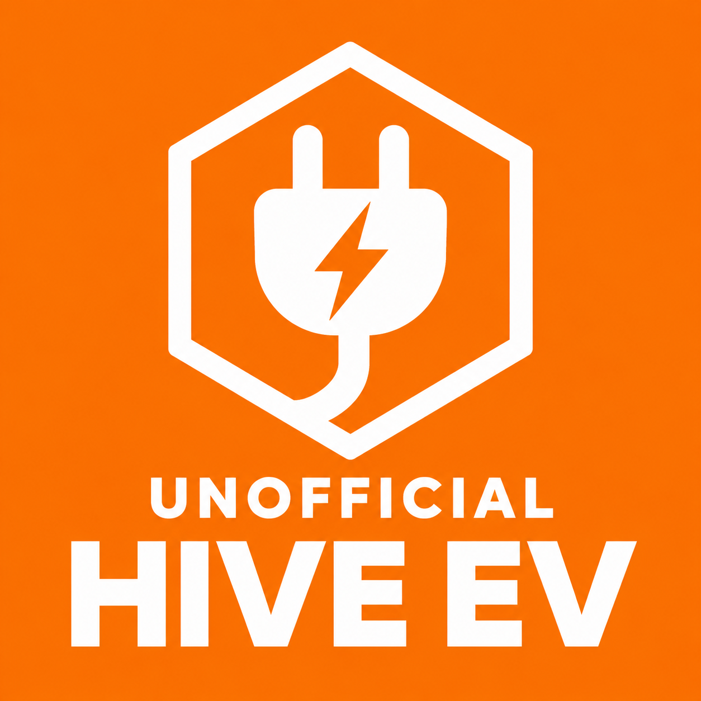

# Hive EV for Home Assistant

**0.2.0 — unofficial community release.** Monitor a Hive-connected EV charger and optionally enable two experimental manual controls: **Charge now** and **End charging session**. Controls are off on a new installation. Pause/resume and schedule editing are not included.

Tested by one owner with a Hive-connected **Alfen NG910, firmware 5.8.1-4123**, using Home Assistant OS. The charger remains connected to Hive over its existing mobile connection; no local charger connection or backend change is required. Other charger models, Power+/DSR control and multiple-charger control are not validated. This is unofficial and is not endorsed by Hive, Alfen or Home Assistant.

**End session can unlock the cable, leave Finishing, and require unplugging/reconnection before scheduled charging is ready again. It is not Pause.** Saved schedules are not edited, but readiness after ending a session must be checked in Hive. Keep the existing Hive integration for heating and other devices.

## Features

- Reported charging status and session-active flag. An active session can be Scheduled or Paused at 0 W.
- Charging power (W), session energy (Wh), and session charging duration (seconds), added when Hive first supplies them. Missing values stay unknown.
- Optional **Energy dashboard helper**: a cumulative kWh estimate from reported power, disabled by default and independent of supplier/pricing.
- Optional **Charging cost helper**, configured with your own current electricity-rate sensor; cumulative cost and daily/weekly/monthly Statistic-card views.
- Last successful refresh, recording cloud receipt time. Polling is every 60 seconds; this is not a direct charger freshness measurement.
- Optional **Charge now (experimental)** and **End charging session (experimental)** buttons, with explicit owner/Alfen enrollment and fresh-state checks.
- An explicit diagnostic download containing bounded technical shapes and redacted metadata, using the existing authenticated session.

Session energy/duration reset between sessions. Session energy is not a lifetime energy total or an Energy dashboard consumption source. For the dashboard, enable the native **Energy dashboard helper** on the charger device and select it for energy consumption, with **Charging power** for power consumption; see [Energy dashboard and spend](docs/energy-dashboard.md). For charging spend, optionally select a current unit-rate sensor in Hive EV Configure. No supplier-specific entity is built in. The native cost helper is separate from the Energy dashboard device chart; its daily change can be shown with a Statistic card. The older manual GBP package remains an alternative.

## Install with HACS (recommended)

Requires Home Assistant Core **2026.10.4 or newer** and HACS already installed. If you need HACS on Home Assistant OS, follow the official [Get HACS instructions](https://www.hacs.dev/docs/use/download/download/) and complete its GitHub authorization first.

1. Back up Home Assistant. If upgrading an existing Hive EV installation, disable experimental controls in Configure first.
2. Open **HACS** in the Home Assistant sidebar → **⋮** (top right) → **Custom repositories**.
3. Paste `https://github.com/domleblanc94/hive-ev`, choose type/category **Integration**, and select **Add**. This is not an add-on repository or a dashboard plugin.
4. Find **Hive EV (unofficial)** in HACS, open it, select **Download**, and choose **0.2.0**. If already downloaded, use **⋮ → Redownload**. Normal 0.2.0 does not require enabling beta versions.
5. **Restart Home Assistant.** On a first installation, open **Settings → Devices & services → Add integration → Hive EV**, sign in with your Hive account-owner login and complete SMS verification.
6. On an upgrade, **reuse your existing Hive EV integration entry**. Do not delete/re-add it; verify monitoring resumes, then inspect Configure. Your existing options are retained. HACS replaces the component files; it does not automatically enable controls or configure price sensors.

Already installed manually? Add this custom repository and download the same `hive_ev` integration over the existing files after your backup; keep the configured entry and restart. HACS and the manual ZIP are alternative ways to update the same integration, not two integrations to add. Later updates can be downloaded through HACS and followed by a restart. See [HACS installation and troubleshooting](docs/hacs-installation.md).

## Manual install or upgrade

1. Back up Home Assistant and the existing `custom_components/hive_ev` folder. If upgrading from a private experimental build, disable experimental commands in Configure first; existing options are retained during an upgrade.
2. Extract the release ZIP, or copy this repository's `custom_components/hive_ev` folder, into your Home Assistant configuration directory. The resulting path must be `/config/custom_components/hive_ev/manifest.json`; avoid an extra nested folder. File editor, Studio Code Server or Samba can provide access.
3. Restart Home Assistant. For upgrades, reuse the existing Hive EV entry and verify that monitoring resumes. Do not remove/re-add it just to upgrade.
4. On a new installation, open **Settings → Devices & services → Add integration → Hive EV**. Sign in with the Hive account owner and complete normal SMS verification. If Hive requires a trusted sign-in device, setup offers an initially unchecked registration checkbox to support unattended renewal.
5. Check status and power against Hive before enabling controls. Existing private experimental options may already be enabled after an upgrade; inspect Configure explicitly.

The project repository is [domleblanc94/hive-ev](https://github.com/domleblanc94/hive-ev). Download the installation ZIP from [GitHub Releases](https://github.com/domleblanc94/hive-ev/releases). Install through HACS as a **custom repository**, or use the manual installation ZIP. This project is not listed in the default HACS catalog. See [publication steps](PUBLISHING.md).

## Optional experimental controls

Open **Settings → Devices & services → Hive EV → Configure** and confirm both experimental enrollment and ownership of the single Alfen charger. Enabling options alone does not send a command.

| Button | Current beta guard | Meaning |
|---|---|---|
| Charge now | Active Custom/Tariff scheduled session, settled eligible state, no override, reported 0 W | Requests a Charge Now override; electricity may be bought at the current rate |
| End charging session | Active Charge Now override reporting Charging and positive power | Ends/unlocks the session; Finishing and reconnection may follow |

This beta deliberately restricts End session to a charging override; it is not a general stop button for every scheduled/idle state. Missing, conflicting or pending readings, unsupported modes and multiple monitored chargers are refused. A nearly full car drawing no power cannot complete the end-session trial through these buttons.

Use the buttons only for supervised manual trials. There is one attempt per action per integration runtime and a 60-second cooldown. No write is automatically repeated. Uncertain delivery disables controls persistently: inspect Hive and the car before explicitly enabling again. Restarting/reloading resets runtime attempt limits; it does not cancel a request already delivered. Do not use reloads or automations to bypass those limits.

After End session, confirm power has stopped, follow Hive's unplug/reconnect instructions if shown, and verify saved times, override clearance and scheduled readiness before leaving. Earlier automatic recovery without unplugging was also observed, so reconnection is not claimed to be universally necessary. See [the control guide](docs/controls.md) for the complete trial and rollback procedure.

## Evidence and limitations

The owner supplied an overnight log showing Scheduled → Charging → Completed with 680 successful refreshes across approximately 11 hours 25 minutes. History exports show **6,973–7,108 W** active power and energy rising to **7.11 kWh**; a sensor screenshot reports **3,690 seconds**. Restart recovery without another sign-in is user-reported. See [overnight results](docs/overnight-results.md).

On 3 November 2026 the owner used the private precursor's Charge Now button and observed **5,825 W**. End session produced Finishing, 0 W and session inactive; reconnection returned to Scheduled. The subsequent diagnostic download also worked. These are one-account observations of the predecessor builds, separate from release-candidate automated tests; they are not independent meter verification or a broad compatibility claim.

See [testing](docs/testing.md) and [release validation](docs/release-validation.md) for automated results and remaining checks. Sustained renewal/expiry recovery, detailed registry checks, further hardware variants and repeated control cycles need more evidence. Hive can change this undocumented interface.

## Authentication, diagnostics and support

Credentials are entered only in Home Assistant. Its config-entry storage retains tokens, expiry, account identity and an optional trusted-device key; cost options also store the selected local rate entity ID and currency; account and device passwords are not retained. Protect backups because they can contain tokens. Normal reauthentication may require another SMS. Removing this integration does not automatically revoke a Hive trusted sign-in record.

Use the integration entry's three-dot menu → **Download diagnostics** for technical troubleshooting. The component excludes credentials, account/device identifiers, arbitrary values and raw readings from its data. Home Assistant may add standard system/integration metadata and an entry-derived filename outside that sanitizer. Review the file before sharing. Diagnostic downloads do not activate controls or send charging commands. See [diagnostics](docs/diagnostics.md).

For a bug report, provide the integration version, Home Assistant version, charger model, observed states, expected result and a reviewed error/diagnostic summary. Do not share `.storage`, credentials, raw API replies or personal screenshots. For uncertain command outcomes, resolve the charging state in Hive first.

## Development and attribution

**OpenAI Codex generated the implementation, tests and documentation using user-directed agents.** The owner supplied requirements, performed normal local authentication, installed the component and supervised the hardware trials. AI review is not human review or maintainer acceptance.

The API was identified by copying the installed official Android APK with ADB/USB debugging, inspecting its Hermes bundle locally, and tracing normal authentication and request paths. Initial control-host tracing was wrong and corrected after a rejected request. No MFA bypass or private app database was used. APKs, decompiled code, raw account data and detailed untested device/history research are excluded.

See [development and provenance](docs/development-and-provenance.md), [architecture](docs/architecture.md), [CONTRIBUTING.md](CONTRIBUTING.md) and [next steps](docs/next-steps.md). The separate [Home Assistant Core contribution](docs/upstream-contribution-plan.md) remains monitoring-only and needs a compatible published client-library release; this custom component is not that upstream patch.
