# Architecture

This draft documents the monitoring-only `hive_ev` custom integration. It is separate from Home Assistant's built-in Hive integration. The development account's Alfen NG910 was discovered through Hive's modern cloud API while remaining connected to the Hive app. Broader charger compatibility has not been established.

## Data flow

```mermaid
flowchart LR
    Setup[Home Assistant setup and SMS verification] --> Cognito[Hive Cognito authentication]
    Cognito --> Tokens[Home Assistant config entry tokens]
    Tokens --> Poll[Shared coordinator: 60 seconds]
    Poll --> Homes[Hive proxy: account homes]
    Homes --> Nodes[Hive proxy: version 6.5 nodes]
    Nodes --> Parser[Reported-value parser]
    Parser --> Entities[Status and session sensors]
```

`config_flow.py` handles account-owner sign-in, SMS verification and reauthentication. `auth.py` performs authentication and renewal. Where Hive requires new-device registration for renewal, setup presents a separate, initially unchecked consent step to register **Home Assistant Hive EV** as a trusted sign-in device. This is account authorisation, not charger association.

The integration retains the ID token, refresh token, expiry, user ID and optional trusted-device key in Home Assistant's normal config-entry storage. It does not retain the account password or a device password. Removing the integration does not automatically revoke the corresponding trusted sign-in record in Hive.

`api.py` reads the authenticated account's homes, then requests each home's nodes from Hive's proxy using the `application/vnd.alertme.zoo-6.5.0+json` representation. The version matters: the app's version 6.6 discovery supplies broker metadata rather than the reported features needed by this parser. Authentication uses Hive Cognito; proxy reads also use the application's embedded client key. That shared client key is not the user's credential, and is not a substitute for the user's authenticated account access. Its inclusion is not evidence of a supported public API or permission from Hive.

`coordinator.py` shares one polling cycle among entities and translates authentication failures into reauthentication requests. Connection or representation failures make entities unavailable. `sensor.py` and `binary_sensor.py` create entities with stable internal node-based identities; removed nodes become unavailable.

## What a reading means

The verified EVSE node uses `features.ev_supply_equipment_v1`. The status comes from `displayState.reportedValue`; session activity comes from `transactionActive.reportedValue`. Requested `targetValue` data is deliberately not used as observed telemetry.

The development account returned `AVAILABLE` and `transactionActive: false` in an initial live read. The user subsequently reported Scheduled in the Hive app. **Available does not establish cable disconnection. An active transaction does not establish power delivery.** A paused or scheduled session may draw no power. Physical charging needs corroborating power telemetry or observation in the Hive/car interface.

When present, `transactionActivePowerImportW`, `transactionEnergyTotalWh` and `transactionChargeTimeSeconds` provide power, session energy and charging duration. Missing or invalid numbers remain unknown, not zero. These measurements were absent from the initial idle response. Optional entities are added when first observed. Session energy and duration can reset, so they are not exposed as cumulative lifetime statistics.

The last-successful-refresh sensor records receipt of a successful cloud poll, not the charger's original reporting time. Successful receipt alone does not prove a fresh physical measurement.

## Controls and schedules

The monitoring integration has no charging buttons, switches, services or schedule writes. Continue using Hive for control.

A separate supervised trial tool investigates app-equivalent session commands. Static inspection identified native stop as `cableUnlock`, secure approval as `authorise`, and temporary schedule override as `transactionOverridden`. These actions have different semantics. An initial START request used an incorrectly traced host and was rejected. With the independently checked correction, START was acknowledged and reported Charging with override true; STOP was acknowledged and reported Finishing with an inactive transaction. Physical power delivery was not established.

A subsequent read-only observation while the user operated Hive itself reproduced Scheduled → Charging with override true → FINISHING with `transactionActive: false`. Finishing persisted for the observed 90 seconds, and the saved tariff values compared during the test were unchanged. This matches the corrected trial's observed end-session pattern. It does not demonstrate a pause operation or an alternative cancel-override action; no `transactionOverridden: false` command has been proved.

Recovery depends on conditions not yet understood. The user supplied earlier charger-history evidence of Finishing → Available → Preparing → SuspendedEVSE at zero current without going outside or unplugging. In another run, reconnection returned the charger to Scheduled; a later manual-app Stop also prompted unplugging. These observations do not support a universal claim that every Stop requires unplugging, or that every Stop automatically restores readiness. Saved-schedule preservation alone does not prove overnight charging will run. The trial remains separate from the monitoring integration.

## Operational limits

This is cloud polling against undocumented app interfaces, not a local Alfen connection. It depends on Hive authentication, service availability and response compatibility. One overnight run now supports scheduled charging and continuous polling with reported session measurements; see [overnight results](overnight-results.md). The owner separately reports updates resuming after a Home Assistant restart without another sign-in. Specific refresh-token renewal events, detailed restart/registry checks and compatibility across charger models remain unverified. A full Home Assistant runtime validation is also distinct from the local tests described in [testing.md](testing.md).
