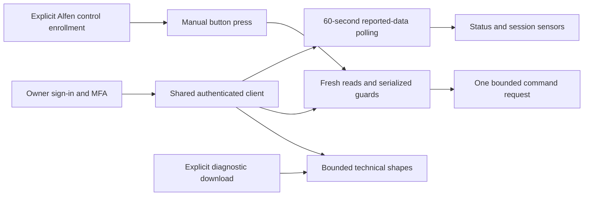

# Architecture

The standalone `hive_ev` custom integration provides reported monitoring, optional experimental manual controls and explicit diagnostics. It is separate from the built-in Hive integration and its monitoring-only upstream contribution.

## Authentication and monitoring

Normal owner sign-in and SMS verification produce tokens stored in Home Assistant's config entry. When trusted-device registration is required, a separate initially unchecked consent step supports unattended renewal. Account and device passwords are not retained. Removing the entry does not automatically revoke a Hive trusted sign-in record.

`api.py` reads account homes and their nodes from the Hive proxy, using the 6.5 representation and TLS. The shared coordinator polls every 60 seconds. Authentication failures request reauthentication; failed reads make entities unavailable. Token changes are saved without reloading the control runtime.

The EVSE fields provide reported status, transaction activity, power, session Wh and charging seconds. Target values never substitute for observed telemetry. Missing measurements remain unknown, optional sensors are added when first reported, and removed nodes become unavailable. Session energy/duration can reset; they are not lifetime totals. Last successful refresh is the receipt time, not proof of a fresh physical sample.

## Optional Energy dashboard estimate

`energy_helper.py` adds a default-disabled RestoreSensor when valid power is discovered. It exposes ENERGY, kWh and TOTAL_INCREASING metadata and explicitly marks the value as estimated/helper. It integrates the preceding reported power over successive UTC receipt timestamps. A valid stored kWh total restores independently of session Wh, while the first observation establishes a new baseline. Failed/missing observations clear the baseline; duplicate/reversed timestamps add nothing and intervals over 180 seconds are skipped. There are no extra network requests, timers, pricing dependencies or charger writes. See [Energy dashboard](energy-dashboard.md).

## Optional cost estimation

User-selected local electricity-rate data can feed a cumulative monetary estimate. Selection is optional and independent of experimental controls. Reported power and current rate observations determine intervals; rate changes split those intervals. Invalid readings and stale/unobserved intervals are skipped. Currency-specific identities prevent incompatible currencies from sharing a restored total. Negative tariffs are credits, so monetary statistics use TOTAL rather than TOTAL_INCREASING. No tariff/schedule settings or electricity-provider accounts are written. See [cost setup and daily views](energy-dashboard.md).

## Optional manual controls

`config_flow.py` offers explicit owner/single-Alfen enrollment. Buttons load only when both options are true; new installations default to off. Upgrades retain existing options. Disabling/unloading invalidates old controllers and unloads active handlers. Historical registry entries may remain unavailable. Tests cover options changing while a preflight is suspended and re-enabled, so the old runtime cannot resume a command.

`controls.py` serializes by device, re-reads discovery and selected EVSE state, and refuses unsupported modes, multiple chargers, missing/contradictory targets and pending unlocks. Charge Now requires a settled active scheduled session at 0 W without an override. End requires an active override reporting Charging and positive power. The latter is a deliberately narrow supervised-trial scope.

The app-equivalent request writes only one EVSE attribute: true `transactionOverridden` for Charge Now or true `cableUnlock` for End. The verified write transport is `https://api-prod.bgchprod.info/omnia/nodes/{id}?homeId=...`, using the existing Bearer token and 6.5 representation, without the proxy's shared app key. No schedule fields, linking, OCPP destination or installer settings are written.

Each action consumes an attempt before transport, at most once per runtime, with a cooldown. PUT is bounded, TLS-verified, not redirected and never automatically retried after an authorization/transport/service failure. Uncertain delivery blocks the controller and disables enrollment persistently. Reload/restart resets runtime attempt limits, but cannot cancel an earlier delivered request. No optimistic physical state is applied; reported reads remain authoritative. Acknowledgment alone is not charging confirmation.

End is a session-ending/unlock action, not Pause. The owner saw Finishing/0 W/inactive and recovered after reconnecting. Earlier automatic readiness recovery was also observed. Neither universal reconnection nor universal same-plug readiness is claimed. See [controls](controls.md).

## Explicit diagnostics

`diagnostics.py` uses existing authenticated node reads only on Download diagnostics. `diagnostic_shapes.py` bounds device/home scans, EV node selection, technical field counts, sampled collection sizes and serialized output. Known keys and strict technical metadata are retained; unknown keys are hashed and raw readings/identifiers/credentials excluded. No settings endpoint or command is invoked. The standard Home Assistant envelope/filename is outside the component sanitizer. See [diagnostics](diagnostics.md).

## Limits

This depends on an undocumented cloud interface and normal Hive authentication. One owner's Alfen and limited supervised trials are the hardware evidence; synthetic tests are separate. Pause/resume, general scheduled-session stopping, unattended automation, other charger variants and EV-only upstream setup are not established by this release. Full [testing](testing.md) and [provenance](development-and-provenance.md) records distinguish those limits.
